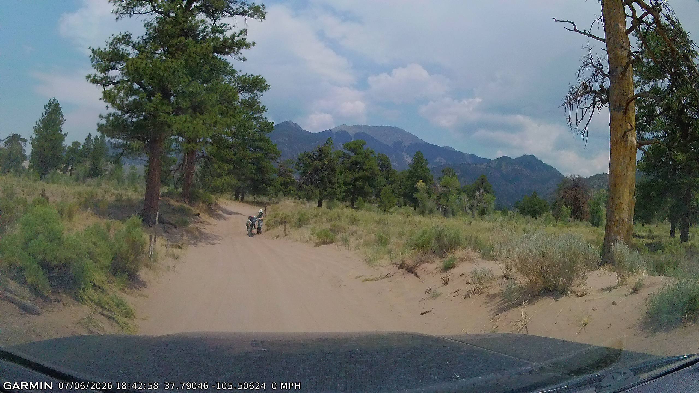
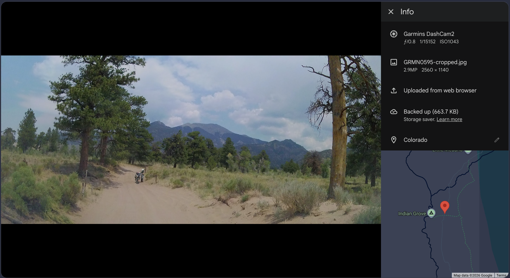

[](https://github.com/klaeufer/dashcamutils/actions/workflows/ci.yml?query=branch%3Amain)
[](https://github.com/klaeufer/dashcamutils/actions/workflows/codeql.yml?query=branch%3Amain)
[](https://github.com/klaeufer/dashcamutils/actions/workflows/actionlint.yml?query=branch%3Amain)
[](https://www.python.org/downloads/)
[](https://github.com/klaeufer/dashcamutils/blob/main/LICENSE)
[](https://github.com/klaeufer/dashcamutils/commits/main)


# Purpose

The current line of Garmin dash cams include a timestamp and GPS information visually in the image.



This utility extracts this information using OCR, parses it, and populates the corresponding EXIF metadata.
It then crops the image to remove the timestamp and usually the vehicle hood.




# Dependencies

- Python 3.12 or later

All other dependencies are Python packages installed automatically:

- Pillow (cropping and rotation) and NumPy (hood and tilt detection);
- RapidOCR, running on ONNX Runtime (OCR);
- piexif (EXIF metadata);
- tzdata, on Windows only, for named time zones such as `America/Chicago`.

RapidOCR downloads its models the first time it runs, so the first run needs internet access.

# Usage

The command is `dashcam-tag`; the earlier name `tag_images` still works as an alias.

> **Warning: work on copies.** Processing changes original EXIF metadata and file
> timestamps in place, but does not change the original pixels. No backup is created.
> By default, local-time EXIF tags are removed when a location is available (see below).
> Existing cropped outputs are overwritten on reruns; regenerated OCR text and timestamp
> strips are overwritten too.

Typical use, on a folder of images listed in capture order:

```
dashcam-tag --repair -z America/Chicago GRMN*.JPG
```

Hood crop and tilt are detected automatically, stamps are repaired from their neighbours,
and each image is tagged and cropped.

With no image arguments, the tool processes `ManualTimestamps.txt` in the current working
directory if it exists. If neither images nor that file are supplied, it prints usage and an
example, exits with status **2**, and performs no processing.

Routine CLI output shows warnings and errors by default. Per-image progress remains visible
on stderr. Use `--verbose` when you want informational details such as effective settings,
additional processing diagnostics, and RapidOCR initialization messages. Recoverable
timestamp/GPS parsing skips are warnings and still produce a nonzero exit status; errors are
reserved for operational failures such as OCR, metadata, or output-write failures.

### Manual recovery

When processing reports invalid timestamps, use this workflow:

1. Find the entries in `InvalidTimestamps.txt`.
2. Copy them to `ManualTimestamps.txt` and edit the timestamp/GPS text as needed.
3. Validate the file without modifying images or OCR sidecars:
   `dashcam-tag --validity_check_manual`.
4. Apply valid entries with `dashcam-tag`, preserving the same `--timezone` and other
   relevant processing options used for the original batch.

Validation returns **0** when every entry is valid, **1** when any entry is invalid, and
**2** when `--validity_check_manual` is requested but `ManualTimestamps.txt` is missing.
The `--skip_ocr` option reuses each image's per-image text sidecar; it does not read the
aggregate `ManualTimestamps.txt` file directly.

Manual entries normally require both a timestamp and GPS location. To deliberately recover
time without coordinates, opt in with `--allow-time-only-manual` for both validation and
application:

```sh
dashcam-tag --allow-time-only-manual --validity_check_manual
dashcam-tag --allow-time-only-manual -z America/Chicago
```

Time-only entries do not fabricate GPS coordinates or speed. Existing GPS metadata in the
image is preserved, and local-time EXIF tags are kept when no replacement location is
supplied. Coordinate-bearing entries continue to behave normally.

```
usage: dashcam-tag [-h] [-c CROP_BOTTOM] [-r ANGLE] [-z TIMEZONE]
                   [--hood-method {batch,boundary}] [--hood-margin HOOD_MARGIN]
                   [--hood-reference-fraction HOOD_REFERENCE_FRACTION]
                   [--hood-overrides HOOD_OVERRIDES]
                   [--gps-time-only | --no-gps-time-only] [-d {auto,mdy,dmy}]
                   [--hemisphere {NW,NE,SW,SE}] [--repair]
                   [--interpolate | --no-interpolate] [--sort-by-time] [-s]
                   [-v] [--verbose]
                   [image ...]

  -c, --crop-bottom CROP_BOTTOM
                        nonnegative pixels to crop from the bottom (0 disables
                        cropping), or auto (default) to detect the hood from
                        the batch
  -r, --angle ANGLE     rotation in degrees counterclockwise, as in
                        PIL.Image.rotate, or auto (default) to estimate the
                        camera tilt from the batch
  --hood-method {batch,boundary}
                        hood crop estimator; boundary is experimental, batch
                        is the default
  --hood-margin HOOD_MARGIN
                        pixels to retain above the estimated boundary (boundary
                        method; default 10)
  --hood-reference-fraction HOOD_REFERENCE_FRACTION
                        image-width fraction used for center-reference crop
                        (boundary method; default 0.3333)
  --hood-overrides HOOD_OVERRIDES
                        JSON object keyed by image path with manual crop/angle
                        or per-column boundary/angle overrides
  -z, --timezone TIMEZONE
                        time zone the camera clock is set to: UTC (default),
                        an offset like -05:00, or a name like America/Chicago
  --gps-time-only, --no-gps-time-only
                        write the time only as UTC GPS date/time and remove
                        the local-time tags, so Google Photos infers the time
                        zone from the location (default; images without a
                        location keep their local-time tags)
  -d, --date-order {auto,mdy,dmy}
                        how to read ambiguous nn/nn/yyyy dates; auto
                        (default) infers it from unambiguous stamps
  --hemisphere {NW,NE,SW,SE}
                        expected hemispheres of latitude then longitude
                        (default NW; the camera prints '-' for S and W)
  --repair              repair misread stamps by fuzzy parsing and checking
                        them against neighbouring images (capture order)
  --interpolate, --no-interpolate
                        with --repair, estimate the position of images whose
                        GPS can't be read from their neighbours (default)
  --sort-by-time        with --repair, process images in the order of their
                        readable timestamps rather than the order given
  -s, --skip_ocr        skip extraction of timestamp using OCR
  -v, --validity_check_manual
                        check validity of manual timestamps
```

`--crop_height` and `--rotation_angle` remain as aliases. Note that positive angles now
rotate counterclockwise (Pillow convention; ImageMagick rotated clockwise), so negate
angles previously used with ImageMagick. After rotating, the output is automatically
cropped to remove the empty corner wedges, so rotated images come out slightly smaller.

## Time stamp formats and time zones

The stamp format is detected automatically: `yyyy/mm/dd`, and `mm/dd/yyyy` or `dd/mm/yyyy`
with either a 24-hour or AM/PM clock. A date such as `23/10/2022` can only be day-first,
and once one is seen the rest of the batch is read the same way; a lone ambiguous date
like `03/04/2022` is read month-first unless you pass `-d dmy`.

The stamp carries no time zone, so it is assumed to be UTC. If your camera clock is set to
local time, pass `-z`. The UTC `GPSDateStamp`/`GPSTimeStamp` and the file modification time
are always written; with `--no-gps-time-only` the stamp is also written to `DateTimeOriginal`
as shown, together with `OffsetTimeOriginal`.

Google Photos can get confused by local-time tags that don't match the position, so by
default `DateTimeOriginal`, `DateTimeDigitized`, `DateTime`, the `OffsetTime*` and
`SubSecTime*` tags are removed, leaving only the UTC GPS date and time, from which Google
Photos works out the local time zone of the location. Images with no location keep their
local-time tags, since there is nothing to infer a zone from. Pass `--no-gps-time-only`
to keep `DateTimeOriginal` and `OffsetTimeOriginal` as described above. Note that the
removed tags are gone from the original once it is processed.

## What is changed and written

The original images are modified in place, and only their metadata: the EXIF block (GPS
position and time, the tags above, and a `UserComment` note on images whose position was
interpolated) and the file access and modification timestamps. Their pixels are not touched.
By default, local-time EXIF tags are removed when a location is available. There is no
backup, so work on copies if you want to keep the original metadata and file timestamps.

Per-image artifacts are written **beside each input image**, even when it is outside the
current working directory:

- `<name>-cropped.jpg`: the rotated and cropped image, with the same EXIF;
- `<name>.txt` and `<name>-timestamp.jpg`: the OCR text and the stamp strip it was read from;

Regenerating these artifacts overwrites existing files at those paths. With `--skip_ocr`,
the tool reuses existing per-image `.txt` files instead of regenerating OCR text and timestamp
strips; cropped outputs are still regenerated.

The default report paths, **`InvalidTimestamps.txt` and `RepairedTimestamps.txt`, are in the
current working directory**, not necessarily beside the images. Reports append across runs
and can contain duplicate entries.

For example, from a working directory separate from your copied images:

```sh
dashcam-tag --repair -z America/Chicago /path/to/image-copies/GRMN*.JPG
```

The cropped JPGs, OCR text, and timestamp-strip JPGs go in `/path/to/image-copies/`; failure
and repair reports go in the directory where you ran the command.

## Repairing misread stamps

OCR often garbles a stamp: separators read as digits, letters for digits, a dropped digit.
Without `--repair`, a stamp that can't be parsed is reported and the image skipped, and the
tool suggests `--repair` when that happens. With `--repair`, all the images are read first (list them in capture order, e.g. a shell
glob) and each stamp is parsed tolerantly into several candidate readings. A reading that
is clean and consistent with its neighbours is trusted; for the others the candidate is
chosen that keeps time moving forward, the date equal to the batch's, and the distance
travelled plausible for the elapsed time, and single-digit errors in the coordinates are
corrected when that makes them fit. Signs follow the camera's `-` for S and W; `--hemisphere`
says which signs to expect when none is visible, and a reading whose signs contradict it
needs the neighbours' support to be believed.

Repair works in stages, and each image gets the best result that can be justified:

1. a clean or repairable stamp is tagged with its time and position;
2. if only the GPS part is unreadable, the position is interpolated linearly between the
   nearest located neighbours (unless `--no-interpolate`), provided they are within 10
   minutes of each other, and the image is marked in the EXIF `UserComment`;
3. otherwise the image is tagged with its time only and the position is left blank, to be
   added later by hand if wanted;
4. only if even the time can't be read does the image go to `InvalidTimestamps.txt`.

Every image that is not a clean reading is listed in `RepairedTimestamps.txt` (with the
status `repaired`, `interpolated` or `time-only`) next to what OCR read, so they can be
reviewed. A batch is assumed to use one date format throughout, as a camera writes them:
the format most cleanly read stamps agree on is chosen, and readings in any other format
are ignored with a warning. OCR is also retried on the stamp with a few preprocessings (contrast,
binarising, padding) when the first reading doesn't parse cleanly. Interpolation is
not attempted across gaps over 10 minutes.

Repair assumes the images are listed in capture order; if the readable timestamps run
backwards a warning is logged, and `--sort-by-time` reorders the batch by them instead.
Repair is a heuristic: it works best on densely sampled sequences, where neighbours constrain each stamp tightly.

## Automatic hood crop and rotation

Unless you pass `-c` and `-r`, both are estimated once from the whole batch (up to 40
evenly spaced images, at least 5) and logged, so you can reuse the values explicitly.

- **Hood (`-c auto`)**: the hood's crest shows up as a step, in the central columns, in
  both average brightness and how much the picture changes from frame to frame (the hood
  changes less than the scenery, even when it is dark and reflective). The crop is
  everything below that step. It needs a moving car with varied scenery and at least
  5 images; if the scene barely changes (parked) or no clear step is found, no cropping is done.
- **Camera moved mid-batch**: with `-c auto`, the batch is also checked for a jump in
  the hood edge (for example the camera got knocked between drives). If one is found, a
  warning lists where, and each stretch gets its own crop and tilt. The split point is
  accurate to a few images in very long batches. An explicit `-c` disables this.
- **Tilt (`-r auto`)**: the camera's roll is found by searching for the rotation that
  lines up the scene's vertical edges (trunks, poles, buildings) best. It is only applied when
  most images show clear vertical structure and agree; otherwise there is a warning and no rotation. Dense
  forest or winding roads often give too little to go on, so check the result and pass `-r`
  yourself if it declines or looks wrong.

### Experimental per-image hood-boundary mode

`--hood-method boundary` selects an experimental estimator that finds a hood edge in each
image, estimates its slope, rotates to level that boundary, and chooses a crop using a
center reference region. It uses the same NumPy and Pillow dependencies as the rest of the
package; it does not require OpenCV. Batch fitting remains the default (`--hood-method batch`)
and is unchanged.

```sh
dashcam-tag --hood-method boundary --hood-margin 10 \
  --hood-reference-fraction 0.333333 --repair -z America/Chicago GRMN*.JPG
```

The default margin is 10 pixels above the detected boundary, and the default reference
fraction is one third of the image width, centered horizontally. The crop removes everything
below the selected line while retaining the full image width. **This center-reference policy
does not guarantee that hood pixels are removed near the left and right edges.** The mode
levels the detected hood boundary; that is not necessarily equivalent to leveling the scene
horizon. It can be uncertain on frames with weak, curved, or competing edges, so inspect the
resulting `-cropped.jpg` files before relying on them. Rotation uses the existing transform
path, which trims empty corner wedges; output dimensions may therefore be smaller than a
simple top/bottom crop would suggest.

Explicit `-c`/`--crop-bottom` and `-r`/`--angle` values take precedence over the corresponding
automatic estimate. To review the transform settings, pass `--verbose`. For persistent
per-image corrections, pass `--hood-overrides overrides.json`. The file is a JSON object keyed
by the image path as supplied to `dashcam-tag` (use the same spelling consistently). For
example:

```json
{
  "GRMN0561.JPG": {
    "crop_bottom": 260,
    "angle": 0.8
  }
}
```

An override may supply `crop_bottom` and `angle` together to bypass automatic boundary
detection for that image. Alternatively, `boundary_y` supplies one y-coordinate per image
column (origin at the top-left; y increases downward) and `angle` supplies the rotation in
degrees. Boundary coordinates must match the image width and fall within its height; manual
angles must be finite and within ±15°. A boundary-plus-angle override is converted into a crop
using the configured margin and reference fraction. Overrides are not scaled automatically if
image dimensions change. These corrections affect the generated crop only; source image pixels
remain untouched, though the tool continues to update source metadata as described above.
